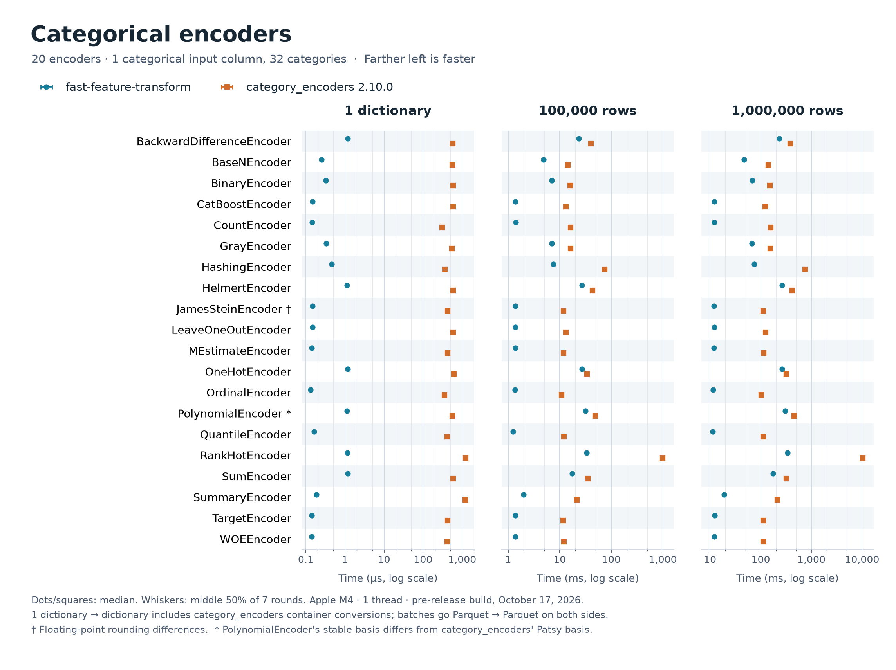
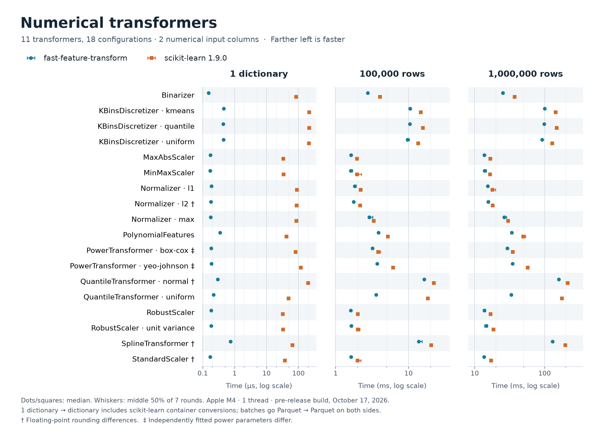

<p align="center">
  
</p>

<h1 align="center">fast-feature-transform</h1>

Feature preprocessing for machine learning, written in C++ with a Python API. Fit a pipeline on Parquet files, save
it, then transform one record at a time when serving or whole files when training.

Demo: https://fare.fast-feature-transform.dev

- **Feature parity** with category_encoders and scikit-learn's preprocessors.
- **Fast:** one record takes 0.13 to 1.2 µs, where scikit-learn takes 32 to 219 µs and category_encoders 0.31 to
  1.2 ms.
- **Out-of-core execution:** Parquet is read in batches, and fits that need every value spill to disk.

## Install

```sh
pip install fast-feature-transform
```

Wheels cover CPython 3.14, standard and free-threaded (`python3.14t`), on Linux x86_64 and arm64 (glibc 2.28 or
later) and on macOS 26 or later on Apple silicon. Elsewhere, build from source as [Development](#development)
describes.

## Usage

```python
from fast_feature_transform import OrdinalEncoder, Pipeline, StandardScaler

pipeline = Pipeline(
    [
        ("country", OrdinalEncoder(columns=["country"])),
        ("numbers", StandardScaler(columns=["age", "income"])),
    ]
).fit(["train.parquet"])

pipeline.transform_dict({"country": "CA", "age": 42, "income": 75000.0})  # serving: one record
pipeline.transform_parquet(["train.parquet"], output_dir="train-features")  # batches: Parquet in, Parquet out
pipeline.transform_memmap(["train.parquet"], output_dir="train-mmap")  # training: one packed file for NumPy

pipeline.save("artifacts/preprocessing")
serving = Pipeline.load("artifacts/preprocessing")
```

## Transform latency

Time to transform one record (a `dict` in, a `dict` out) and batches of 100,000 and 1,000,000 rows, after fitting on
100,000 rows. For one record, category_encoders and scikit-learn also pay to build their DataFrame or array and to
turn the result back into a `dict`. A batch goes from one Parquet file to another on both sides. This package reads
the file's strings as stored, a dictionary of distinct values plus an index per row; category_encoders and
scikit-learn read the file with pyarrow into pandas or NumPy, transform it, and write the result with this package's
Parquet settings. Medians of seven rounds on an Apple M4, one thread; lower is better.





At a million rows scikit-learn took 1.14 to 5.3 times as long and category_encoders 1.2 to 30 times. Reading and
writing Parquet adds time on both sides, which narrows the gap where the transform is cheap or its output wide; it
stays widest where the other library's transform is slow. Matching names don't always mean matching behavior:
categories are sorted, output types are fixed at fit, and `PolynomialEncoder` differs from category_encoders by about
1e-5 at 32 categories and by more than 0.5 from 40 to 128, because category_encoders' basis is the less accurate one.

## Development

How to build, test and change fast-feature-transform.

### Setup

You need [uv](https://docs.astral.sh/uv/) and a C++ toolchain. On macOS, that means macOS 26 or later (the first whose
C++ library parses doubles with `std::from_chars`), the Xcode Command Line Tools and Homebrew. On Linux, it means a
C++26 compiler (CI uses gcc 14) with `bison`, `flex`, `pkg-config`, `perl`, `curl`, `zip`, `unzip` and `tar`. vcpkg
builds OpenSSL for Arrow and Thrift, and OpenSSL's build needs Perl's core modules: on Fedora and RHEL-family systems,
install `perl`, not just `perl-interpreter`.

```sh
make vcpkg         # once per machine: builds a private static Arrow (about 20 minutes)
make dev           # builds the extension into the virtual environment
make check         # formats Python, then lints, type-checks, audits and runs both test suites
make cpp-sanitize  # the C++ tests under AddressSanitizer and UndefinedBehaviorSanitizer
```

- **Python.** Development uses free-threaded CPython 3.14 (`.python-version`). CI also runs the Python tests on
  standard CPython 3.14. To do the same locally, run `uv python install 3.14` once, then set `UV_PYTHON=3.14+gil`
  (a bare `3.14` can pick the free-threaded build). Any warning fails the tests.
- **Arrow** builds through vcpkg into `~/.cache/fast-feature-transform/` (about 3 GB), outside the repository; set
  `FFT_DEPS_DIR` to move it. Deleting it is safe: the next `make vcpkg` rebuilds it. On macOS, `make vcpkg` uses
  Homebrew to install `bison` and `pkg-config`, which Arrow's build needs. The triplets in `triplets/` are vcpkg's own
  plus two settings: Parquet encryption is off, which keeps OpenSSL out of the extension, and macOS builds target macOS
  26. Changing a triplet rebuilds every dependency.
- **The extension** links its own static Arrow and exports a single symbol, so it can share a process with pyarrow.

### Pinned versions

- **Dev tools** (ruff, ty, pytest, bandit, clang-format) are pinned by `uv.lock`. CI runs with `UV_LOCKED=1`, so a
  lock that no longer matches `pyproject.toml` fails. Upgrade with `uv lock --upgrade-package <name>`, run
  `make release-requirements`, and commit the lock and the lists. `pyproject.toml` pins clang-format exactly and ruff
  to 0.16, so edit those pins first.
- **Build tools** (scikit-build-core, nanobind, setuptools-scm, CMake, ninja, and hatch-fancy-pypi-readme, which
  rewrites the README's links for PyPI) are pinned by `build-constraint-dependencies` in `pyproject.toml`; run
  `uv lock` and `make release-requirements` after changing one.
- **Release tools:** `release.yaml` installs cibuildwheel, the tools cibuildwheel installs for itself (pip, build,
  virtualenv and delocate), the build tools, the wheel tests' packages and twine from the lists in
  `.github/requirements`, each pinned to one version with its hashes. `make release-requirements` compiles the lists
  from `cibuildwheel.in`, `cibuildwheel-tools.in` (keep it at the versions cibuildwheel pins) and `twine.in`, and from
  `build-constraint-dependencies`, which it copies to `build-constraints.in`. It exports the `wheel-tests` dependency
  group (what the test suite needs; `dev` includes it) from `uv.lock`, with the lock's own hashes. Run it after
  changing any of those versions or the lock; `test/test_release_requirements.py` fails until then. It keeps every
  other version the compiled lists hold: delete those `.txt` files first to move them too. `release.yaml` runs
  cibuildwheel on the exact CPython its setup-python step names, 3.14.10; move it with each CPython patch release,
  which Dependabot doesn't propose. The workflows pin every action by commit, and Dependabot proposes updates to them
  weekly.
- **C++ dependencies:** `VCPKG_COMMIT` in the `Makefile` and `builtin-baseline` in `vcpkg.json` pin Arrow and
  everything it needs; change both together. `CMakeLists.txt` pins nlohmann_json, unordered_dense and Catch2 by URL
  and SHA-256. The wheels ship `THIRD_PARTY_NOTICES.txt`, which lists every library linked into the extension, and
  SciPy, whose code some kernels follow line by line, with each one's license. When one changes version, a library is
  added or more code is adapted, update the file, and add any new license to the `license` expression in
  `pyproject.toml`.
- **uv** itself is pinned to 0.13.6 in `.github/workflows/build.yaml`, the version that writes the lock. CI takes its
  checksum from the workflow until setup-uv lists it.

### Make targets

| Target | What it does |
| --- | --- |
| `vcpkg` | once per machine: the pinned vcpkg checkout and the static Arrow build |
| `dev` | `uv sync`, which rebuilds the extension when its sources change |
| `check` | `python-format`, `python-lint`, `audit`, `python-test`, `cpp-lint` and `cpp-test` |
| `python-format` | ruff import sort and format |
| `python-lint` | ruff check, format check, and ty |
| `python-test` | pytest |
| `audit` | bandit and `uv audit` (needs the network) |
| `cpp-format`, `cpp-lint` | clang-format, applied or checked |
| `cpp-tidy` | clang-tidy over the C++ test build (run `cpp-test` first), if installed |
| `cpp-test` | the Catch2 suite, as a Debug build with the standard library's own checks |
| `cpp-sanitize` | the Catch2 suite under ASan and UBSan, in `build/cpp-sanitize` |
| `cpp-tsan` | the Catch2 suite under ThreadSanitizer, in `build/cpp-tsan`; `tsan.supp` silences reports from uninstrumented Arrow |
| `cpp-flags` | checks the C++ core and its tests compile with `-ffp-contract=off` (run by the `cpp-*` test targets) |
| `parity-fixtures`, `sklearn-fixtures` | regenerate the expected values from category_encoders and scikit-learn (needs the network) |
| `release-requirements` | the hashed lists `release.yaml` installs from (needs the network) |
| `transformer-benchmark` | five transformers against category_encoders and scikit-learn (needs the network) |
| `label-encoder-benchmark` | `LabelEncoder` against scikit-learn |

CI runs the same checks without formatting, plus `cpp-sanitize` and the standard-CPython tests. ThreadSanitizer runs
weekly and on demand: `gh workflow run build.yaml --ref <branch>` runs every job on a branch.

### Writing C++

- Own resources with RAII: standard containers, `std::unique_ptr`, and no custom copy, move or destructor code where
  members can manage themselves. Writers report errors from an explicit `finish()`; destructors never throw.
- Every one of our translation units compiles with `-ffp-contract=off`, so a multiply then an add rounds twice, as
  NumPy does, under gcc and clang alike.
- Don't loop over a reference reached through temporaries, as in `for (auto e : a()->b()->items())`. gcc 14 destroys
  those temporaries before the loop body runs, where Apple clang keeps them alive (C++23's P2718), so the code
  passes on a Mac and reads freed memory in CI. Bind each owning temporary to a named variable first.
- Prefer plain code to template machinery unless it removes real duplication.

### Profiling

`fft_kernel_benchmark` (`benchmark/kernels.cpp`, arm64 macOS only) runs every kernel in memory, without Python or
Parquet: each case fits on 100,000 rows and transforms a million, then prints the median time per call and a hash of
the output, so two builds can be checked for identical results. On macOS, `benchmark/profile_kernels.py` samples
each case and prints the functions and source lines that take the most time. With the virtual environment active:

```sh
cmake -S . -B build/kernels -G Ninja -DFFT_BUILD_TESTS=ON -DCMAKE_BUILD_TYPE=Release -DCMAKE_CXX_FLAGS=-g
cmake --build build/kernels --target fft_kernel_benchmark
build/kernels/fft_kernel_benchmark --list
build/kernels/fft_kernel_benchmark --case normalize.l2/numeric/null0.00/transform --iterations 50
python benchmark/profile_kernels.py build/kernels/fft_kernel_benchmark --stage transform
```

`--case` picks cases by substring and can repeat. `profile_kernels.py --keep DIR` keeps each case's samples, which
`python benchmark/line_profile.py <binary> <samples> --annotate <function>` prints line by line.
`fft_scaler_benchmark` (`benchmark/scalers.cpp`) times the scaler transforms alone, and
`benchmark/compare_scalers.py` alternates two builds of it.

### Releasing

First add the version's entry to `CHANGELOG.md` on `master`; it doubles as the release notes. Then, on GitHub's
Releases page, draft a new release: type a new tag, `v` and a version such as `v0.0.2` (created on publish), keep the
target `master`, paste the notes and publish. Tick "Set as a pre-release" only for a pre-release, whose tag ends in
`a`, `b` or `rc` and a number, such as `v0.0.2rc1`. setuptools-scm takes the version from the tag.

Publishing runs `.github/workflows/release.yaml`:

1. It checks the release: the repository is public, the release isn't immutable, the tag is `v` and a version, the
   pre-release box matches it, and the tag's commit is on `master`, with no other tag there that setuptools-scm would
   take the version from.
2. cibuildwheel builds the six wheels, CPython 3.14 standard and free-threaded on Linux x86_64 and arm64 (in
   manylinux_2_28 containers) and on macOS 26 arm64, and runs the test suite against each. Each run builds Arrow from
   scratch, about 45 minutes on Linux.
3. A check job records each file's sha256 and confirms the wheels' tags, version and license files; another job runs
   `twine check`.
4. The wheels go to PyPI through trusted publishing: PyPI trusts this repository's `release.yaml` running in the `pypi`
   environment, which only `v*` tags may use, so no token is stored. Just before uploading, the job checks that it
   downloaded exactly the files the check job recorded, and again that the release is still published and its tag
   still names the commit it built.
5. The same files are attached to the release, and the job confirms by sha256 that the release and PyPI hold exactly
   the wheels that were built.

The wheels appear on the release after they reach PyPI, about an hour after publishing. The release page also lists
GitHub's Source code zip and tar.gz, which GitHub makes from the tag when they are downloaded; they aren't uploaded
files, and PyPI has no copy of them. Keep the repository's immutable releases off: an immutable release takes no files
once published.

If a run stops before Publish to PyPI, nothing was uploaded. A re-run sees the release as it was first published, and
editing a release starts no run, so follow the failed job's message: usually, delete the release (and its tag, if the
tag is wrong or must move) and publish again. Deleting a release doesn't stop its run. That run uploads nothing unless a
release on the same tag and commit is published before it reaches Publish to PyPI, so cancel it before publishing again.

Once Publish to PyPI has started, use Re-run failed jobs, which reuses the built wheels: Re-run all jobs builds new
ones, and PyPI refuses a file name it already has with different contents. Finish within 14 days of the first upload,
after which PyPI takes no new files for the version. Don't delete or unpublish the release then: publishing it again
starts a run that rebuilds and fails at Publish to PyPI. If it happens anyway, publish the release again on the same
tag, cancel that run, and re-run the first run's "Attach to the release and compare" job (GitHub allows re-runs for 30
days; after that, attach the six files PyPI lists by hand). If that job finds a wheel on the release that differs from
the build, delete that file from the release and re-run the job.

Running the workflow by hand (Actions, Release, Run workflow) builds and checks the wheels without the release check or
any upload, so try a release that way first.

### Layout

- `src/fastfeaturetransform/`: the C++ core. Parquet reading and writing, the memmap writer, the engine, saving and
  loading, and the transformer kernels under `kernels/`, listed in `kernel.cpp`.
- `src/bindings/`: the Python module `fast_feature_transform._core`, built with nanobind.
- `fast_feature_transform/`: the Python classes, `Pipeline` and every transformer.
- `test/`: the pytest suite. `src/**/*_test.cpp`: the Catch2 suite.
- `triplets/`: the vcpkg triplets (see [Setup](#setup)).
- `benchmark/`: the `LabelEncoder` and five-transformer comparisons, and the native kernel and scaler benchmarks
  (see [Profiling](#profiling)).

## License

MIT. The wheels also contain Apache Arrow and the other libraries that
[THIRD_PARTY_NOTICES.txt](THIRD_PARTY_NOTICES.txt) lists, and code adapted from SciPy, each under its own license.
